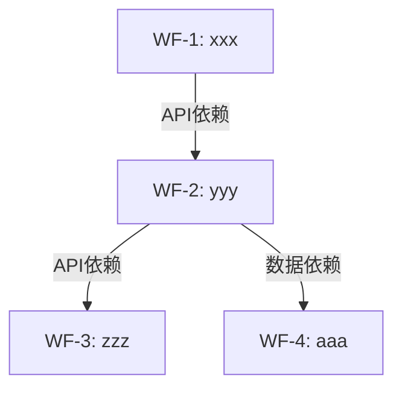
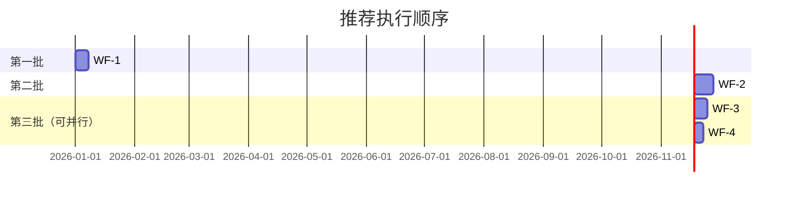

# ss-analysis-report — 拆分报告生成

**阶段**: analysis | **独立可用**: 不推荐独立调用 | **profile**: basic/enhanced

## 前置条件
- 有 `split-result.md`（ss-analysis-split 的产出）。

## 配置加载
本技能的报告产物写入 `PRD_DIR/processing-state/`，子需求文档位于 `PRD_DIR/<NNN>-<slug>/`（与原始 PRD 同级），**不使用** `WORKFLOW_DIR`，因此**无需**读取 `workflow_dir.*` 配置。

同时需确定 **PRD_DIR**（原始 PRD 文件所在目录），由编排器在调用时通过上下文传入。

## 输入
- `--slug <epic-slug>`
- 工作流模式下自动读取 `PRD_DIR/processing-state/02-split-result.md`、`PRD_DIR/processing-state/01-intake.md`

## 执行步骤
1. 读取 `PRD_DIR/processing-state/02-split-result.md`，提取拆分项清单、依赖关系、执行顺序、覆盖映射表。
2. 读取 `PRD_DIR/processing-state/01-intake.md`，提取 Epic 来源信息与已确认范围。
3. 整合为面向人工评审的结构化报告，包含以下章节：
   - 元信息（Epic 来源、拆分日期、拆分项总数、large/small 分布、预估总规模）
   - 拆分总览表（#/拆分项/slug/推荐工作流/规模/依赖/可并行）
   - 拆分详情（每项：推荐工作流+理由、slug、覆盖 Story、GWT 验收标准、预估规模、涉及层、风险项、**子需求文档链接**）
   - **总体依赖关系 DAG 图**（mermaid graph TD：展示所有子需求间的依赖关系全景，标注依赖类型）
   - **总体执行顺序甘特图**（mermaid gantt：可视化展示推荐排期和并行组）
   - 推荐执行顺序（批次 + 并行组 + 里程碑）
   - **子需求文档索引表**（列出所有 `<NNN>-<slug>/<NNN>-<slug>.md` 文件链接及说明）
   - 覆盖映射表（原始 Story → 拆分项 → 覆盖状态）
   - 评审确认清单（checkbox）
4. 校验覆盖映射表完整性：原始 Story 全部出现在映射中，无遗漏。
5. 写 `03-split-report.md` 到 `PRD_DIR/processing-state/`。

## 输出：03-split-report.md 格式

```markdown
# 需求拆分报告：<Epic 标题>

## 元信息
| 字段 | 值 |
|------|-----|
| Epic 来源 | <Jira Key 或描述> |
| 拆分日期 | YYYY-MM-DD |
| 拆分项总数 | N |
| wf-feature-large | X 项 |
| wf-feature-small | Y 项 |
| 预估总规模 | S/M/L/XL |

## 拆分总览

| # | 拆分项 | 建议 slug | 推荐工作流 | 规模 | 依赖 | 可并行 |
|---|--------|-----------|-----------|------|------|--------|
| 1 | <标题> | <slug> | wf-feature-large/small | S/M/L/XL | -/#N | 与#N |

## 拆分详情

### #N <拆分项标题>
- **推荐工作流**：wf-feature-large / wf-feature-small
- **推荐理由**：<Mode A 条件逐项打分结果>
- **建议 slug**：<kebab-case>
- **覆盖原始 Story**：STORY-XXX, STORY-YYY
- **验收标准（GWT）**：
  - Given <前置条件>，When <操作>，Then <预期结果>
  - Given <前置条件>，When <操作>，Then <预期结果>
- **预估规模**：S/M/L/XL（~N 行变更，涉及 <层>）
- **涉及层**：BE / FE / DB / 共享
- **风险项**：（enhanced 模式）<技术风险/依赖风险/规模风险>
- **子需求文档**：[<NNN>-<slug>/<NNN>-<slug>.md](../<NNN>-<slug>/<NNN>-<slug>.md)

## 总体依赖关系图



## 总体执行顺序甘特图



## 推荐执行顺序

1. **第一批（无依赖）**：#N <标题>
2. **第二批（依赖 #N，可并行）**：#N <标题> ∥ #N <标题>
3. **里程碑**：<阶段目标>

## 子需求文档索引

| # | 子需求文档 | 拆分项 | 建议工作流 | 负责端 | 前置依赖 |
|---|-----------|--------|-----------|--------|----------|
| 1 | [<NNN>-<slug>/<NNN>-<slug>.md](<实际相对路径>) | <标题> | wf-feature-large | BE/FE/APP | 无 / [<MMM>-<slug>.md](<实际相对路径>) |

## 覆盖映射表

| 原始 Story | 拆分项 | 覆盖状态 |
|-----------|--------|---------|
| STORY-XXX | #N | ✅ |

## 评审确认

> 评审人确认后将按推荐顺序逐项调用对应 wf-* 执行。

- [ ] 拆分粒度合理
- [ ] 依赖关系正确
- [ ] 无遗漏 Story
- [ ] Mode A/B 分配合理
```

## 完成标准 (Done)
- 报告覆盖全部拆分项，格式完整（含上述全部章节）。
- 覆盖映射表无遗漏（校验通过）。
- 依赖关系无环。
- 每项含可直接作为 wf-* 输入 prompt 的 GWT 验收标准。
- 评审确认清单可供人工勾选。

## basic vs enhanced
- basic：有序列表表示依赖，省略风险项，里程碑仅标注最终联调；仍生成总体依赖 DAG 图和子需求文档索引（简化版）。
- enhanced：mermaid 依赖 DAG 图（含依赖类型标注）+ mermaid 甘特图 + 每项风险项（技术/依赖/规模）+ 并行组可视化 + 阶段里程碑标注。

## 异常处理
- `split-result.md` 中有 BLOCKING 项 → 报告中标注为"⚠️ 待补充"，不阻塞其余项出报告。
- 覆盖映射表校验发现遗漏 → 标 WARNING，在报告末尾追加"未覆盖 Story 清单"提醒评审人。
