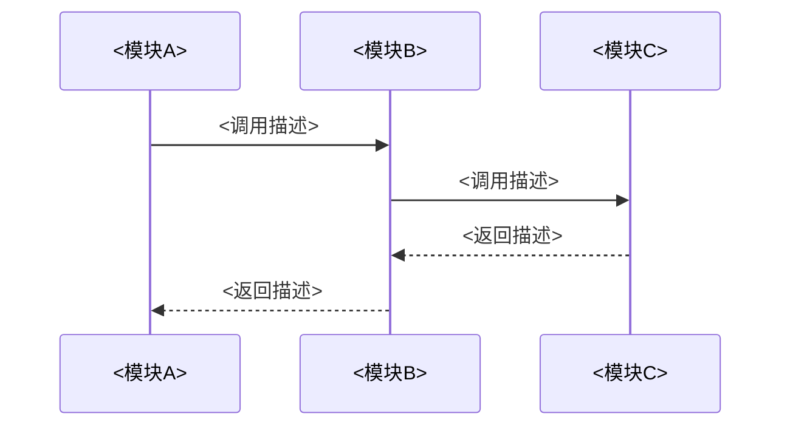
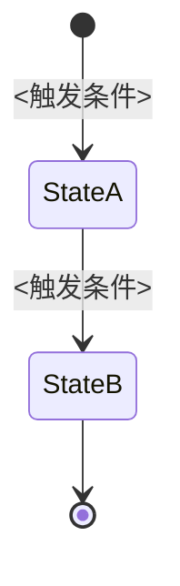
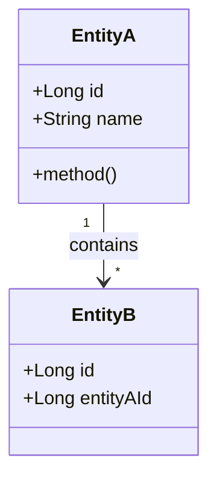
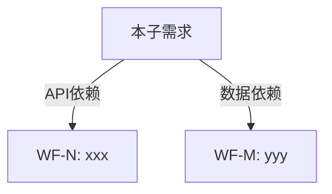

# ss-analysis-sub-doc — 子需求文档生成

**阶段**: analysis | **独立可用**: 不推荐独立调用 | **profile**: basic/enhanced

## 前置条件
- 有 `split-result.md`（ss-analysis-split 的产出，含结构化拆分细节）。
- 有 `intake.md`（Epic 背景信息）。
- 原始 PRD 文件路径可从 `intake.md` 中获取。

## 配置加载
本子需求文档**直接写入 PRD_DIR**（原始 PRD 文件所在目录），不使用 `WORKFLOW_DIR`，因此**无需**读取 `workflow_dir.*` 配置。

**PRD_DIR**（原始 PRD 文件所在目录）由编排器通过上下文传入；独立调用时从 `intake.md` 的 "PRD 来源" 字段推导。

## 输入
- `--slug <epic-slug>`
- 工作流模式下自动读取 `PRD_DIR/processing-state/02-split-result.md`、`PRD_DIR/processing-state/01-intake.md`
- 原始 PRD 文件路径（从 `intake.md` 的 "PRD 来源" 字段获取）

## 执行步骤

### 步骤 1：读取拆分结果与背景
1. 读取 `PRD_DIR/processing-state/02-split-result.md`，遍历每个拆分项，提取：标题、Story 列表、接口概要清单、数据模型变更、状态机定义、关键业务规则、模块交互关系、GWT 验收标准、依赖关系。
2. 读取 `PRD_DIR/processing-state/01-intake.md`，提取 Epic 范围概述、拆分约束、已知约束。

### 步骤 2：逐项生成子需求文档
对每个拆分项，执行以下操作：

3. **回溯原始 PRD（必须穷尽细节，禁止摘要）**：根据拆分项覆盖的 Story ID，从原始 PRD 中逐段提取对应的功能描述、接口设计、数据模型、特殊场景处理、展示信息说明等内容。要求：
   - 拆分项覆盖的每个 Story 在原始 PRD 中出现的**全部**细节（字段定义、业务规则、边界条件、异常处理、文案提示等）必须逐条写入文档，不得仅摘取要点转述；
   - 若某段 PRD 内容同时关联多个拆分项，需在每个拆分项文档中分别完整重现（可重复，不可省略），确保任一拆分项的读者无需回看原始 PRD 或其他拆分项；
   - 原始 PRD 对应章节中存在图片/HTML 原型文件的，需在回溯时记录其行号，供步骤 4 定位并携带。

4. **提取 PRD 关联图片与 HTML 原型文件**（分 5 个子步骤，**不可跳过任何子步骤**）：

   **4a. 全量扫描 PRD 图片**：使用 Grep 工具扫描原始 PRD 文件中**所有**图片引用，**必须同时覆盖两种格式**：
   - Markdown 格式：正则 `!\[[^\]]*\]\(([^)]+)\)` 匹配 ``
   - HTML 格式：正则 `]+src="([^"]+)"` 匹配 ``（Confluence 导出的 Markdown 中大量图片以 `` 标签嵌在 `<td>` 表格单元格内，**极易遗漏，这是已知高频缺陷**）
   - 合并两种格式的扫描结果，去重后得到 PRD 全量图片清单及每张图在 PRD 中的行号

   **4b. 筛选相关图片**：根据图片在 PRD 中的行号与本子需求覆盖的 Story ID / 功能点的上下文关系，判断每张图片是否相关：
   - 图片位于本子需求覆盖的功能点描述段落内 → 相关
   - 图片位于特殊场景表格中且该行描述与本子需求相关 → 相关
   - 如图片内容不明确，可使用多模态能力读取图片判断

   **4c. 重新计算相对路径（禁止照搬 PRD 路径）**：子文档与原始 PRD 同处 `PRD_DIR/` 目录树（子文档位于 `PRD_DIR/<NNN>-<slug>/`，PRD 与图片位于 `PRD_DIR/`），**禁止直接复制 PRD 中的原始相对路径**。必须按以下步骤重新计算：
   1. 确定子文档的绝对目录路径（`PRD_DIR/<NNN>-<slug>/` 展开后的绝对路径）
   2. 确定图片文件的绝对路径（从 PRD_DIR + PRD 中的相对路径解析得到）
   3. 计算从子文档目录到图片文件的相对路径（通常情况下为 `../<PRD 中的原始相对路径>`）
   4. **使用 Bash 工具 `test -f <计算出的路径>` 验证文件可达**，不可跳过
   5. 验证通过后才写入文档

   > **路径计算参考**（子PRD 与 PRD/图片处于 `PRD_DIR` 下的相邻子目录，仅需回退 1 级）：
   > ```
   > 子PRD目录：  <PRD_DIR>/<NNN>-<slug>/
   > PRD目录：    <PRD_DIR>/（即原始 PRD 文件所在目录，例如 knowledge/requirements/active/sprint<YYMM>/<epic-slug>/）
   > 图片示例：   PRD_DIR/images/xxx.png
   > 正确路径：   ../images/xxx.png
   > ```

   **4d. 插入图片**：在文档的"功能需求详述"和"特殊场景"章节中，将图片插入到对应的功能点描述下方

   **4e. 提取 HTML 原型文件链接（强制，不可跳过）**：除图片外，原始 PRD 常以 HTML 原型页面/附件形式承载交互细节，必须同步扫描并携带：
   - 使用 Grep 扫描原始 PRD 中**所有**以下格式的原型/附件引用：
     - `<iframe[^>]+src="([^"]+)"`（Confluence 导出的原型预览常以 iframe 嵌入）
     - `\[[^\]]*\]\(([^)]+\.html?)\)` 与 `<a[^>]+href="([^"]+\.html?)"`（指向本地/附件目录下的 `.html`/`.htm` 原型文件链接）
     - 含「原型」「prototype」「axure」「mockup」关键词的链接文本（需人工判断语义相关性，避免误判无关链接）
   - 按 4b 相同方式判断与本子需求的相关性；按 4c 相同方式重新计算相对路径并用 `test -f` 验证可达（本地文件）或校验 URL 格式合法（外部链接）
   - 写入文档「功能需求详述」对应功能点下方，格式：`- **PRD 原型页面（HTML）**：[<原型标题>](<重新计算的相对路径>)`；外部 URL 则直接写 `[<原型标题>](<URL>)`

   **4f. 语义引用 visual-notes（若存在）**：若 `PRD_DIR/processing-state/01-visual-notes.md` 存在，除搬运原图链接外，还须按拆分项覆盖的 Story/功能点，用相对链接引用 `01-visual-notes.md` 中对应图的结构化提取章节（如 `参见 ../processing-state/01-visual-notes.md §图N`），写入「功能需求详述」对应功能点下方，使子文档读者无需自行读图即可获得图的语义。该产物不存在时（无图/降级跳过）本子步骤跳过。

5. **生成文档内容**，按以下模板结构组织（见"输出格式"章节）。

6. **依赖子 PRD 显式引用（若存在依赖，不可省略）**：若 `split-result.md` 中该拆分项声明依赖其他子 PRD：
   - 文档元信息「前置依赖」字段必须写成 `[<MMM>-<dep-slug>](../<MMM>-<dep-slug>/<MMM>-<dep-slug>.md)` 的 Markdown 链接格式（不能只写编号/名称）；
   - 元信息表下方必须输出一段显式提示语，模板见「输出格式」章节「⚠️ 依赖提示」块（`> ⚠️ 本需求依赖 [<MMM>-<dep-slug>](../<MMM>-<dep-slug>/<MMM>-<dep-slug>.md)，开发前请先阅读该子需求文档：<依赖原因>。`）；
   - 「8. 推荐执行顺序与依赖说明」中每个前置依赖项同样必须使用 Markdown 跳转链接，不得只用纯文本编号。

7. **生成 4 种 UML 图**（均使用 mermaid 语法）：
   - **时序图**：基于模块交互关系和接口调用链，展示核心业务场景的系统间交互流程
   - **状态机图**：基于状态机定义，展示状态枚举和转换条件（无状态流转时标注"不涉及"）
   - **类图/数据模型图**：基于数据模型变更，展示核心实体关系和关键字段
   - **依赖关系图（DAG）**：基于依赖关系，展示本子需求与其他子需求的依赖，标注依赖类型

8. **序号分配 + 冲突检测 + 写入**：按 `wf-prd-split.md` 主文档「子PRD序号命名规则」（NNN 三位序号：百位=父PRD标识、十位+个位=父PRD内顺序）执行：
   - **扫描占用**：Glob 扫描 `PRD_DIR/NNN-*`（本父 PRD 已拆分项），收集已占用 NNN 序号集合（详细规则与示例见主文档）。
   - **百位确定**：新父 PRD 取占用集合最大百位 + 1（首个父 PRD 为 1xx）；同一父 PRD 复用已确定百位，拆分过程中不改变。
   - **父 PRD 内分配**：按执行顺序从 01 递增（`101`、`102`…）；目标序号已占用时在本父 PRD 百位段内累加，**禁止跨越百位边界**。
   - 确认无冲突后 `mkdir -p` 创建目录并写入文件（文件名与父目录名一致，格式 `3位序号-slug`，如 `101-<slug>`）。

### 步骤 3：完成校验
9. 验证每个拆分项都有对应的 `PRD_DIR/<NNN>-<slug>/<NNN>-<slug>.md`。
10. 验证每个文档包含全部 8 个章节（元信息、业务背景、功能需求、接口设计、数据模型、UML图、特殊场景、验收标准）。
11. 验证元信息中"父级 PRD 来源"字段已填写且链接可达：若为 Confluence URL 则验证格式合法；若为相对路径，**必须**从子PRD所在目录（`PRD_DIR/<NNN>-<slug>/`）出发执行 `test -f <路径>` 验证可达。预期路径模式为 `../<epic-slug>.md`。同法验证"拆分过程记录"字段指向 `processing-state/01-intake.md` 的链接可达（预期路径模式为 `../processing-state/01-intake.md`）。
12. 验证所有 mermaid 图语法正确（无未闭合的代码块）。
13. **图片 + HTML 原型文件引用完整性验证**（使用 Bash + Grep 工具逐条验证，**不可跳过**）：
    a. 使用 Grep 扫描原始 PRD 中的全量图片（Markdown `` + HTML `` 两种格式）与全量 HTML 原型文件链接（`<iframe>` / `.html`/`.htm` 链接）
    b. 使用 Grep 扫描所有已生成子文档中的图片引用与 HTML 原型文件链接
    c. 对比：PRD 中与本子需求相关的每张图片、每个 HTML 原型文件链接都必须出现在对应子文档中（无遗漏）
    d. 路径可达性：对子文档中每个图片/原型文件引用，从子文档所在目录执行 `test -f <路径>`，确认文件实际存在（外部 URL 只校验格式合法，不执行 `test -f`）
    e. 任一验证失败 → 标 WARNING 并修复后重新验证
14. **依赖引用完整性验证**（**不可跳过**）：
    a. 逐个拆分项核对 `split-result.md` 中声明的依赖关系是否已在对应子文档中体现（元信息「前置依赖」字段 + 「⚠️ 依赖提示」块 + 第 8 节依赖说明），三处均必须是可跳转 Markdown 链接，不得为纯文本；
    b. 对每个依赖链接，从引用方子文档所在目录执行 `test -f <路径>`，确认被依赖的子 PRD 文件已实际存在（本阶段全部子文档写入完成后统一验证）；
    c. 若被依赖子 PRD 因拆分项 BLOCKING 未生成 → 标 WARNING（不阻断）并在引用处注明「待生成后校验」；若链接为纯文本/编号而未使用 Markdown 链接格式 → 标 WARNING 并修复为正确格式后重新验证。

## 输出格式：PRD_DIR/<NNN>-<slug>/<NNN>-<slug>.md

```markdown
---
name: <NNN>-<slug>
type: sub-req-wf
source: <epic-slug>
dependencies:
  - [<MMM>-<dep-slug>.md](../<MMM>-<dep-slug>/<MMM>-<dep-slug>.md)
  - [<KKK>-<dep-slug>.md](../<KKK>-<dep-slug>/<KKK>-<dep-slug>.md)
---

# 子需求文档：WF-N <拆分项标题>

## 元信息

| 字段 | 值 |
|------|-----|
| 所属 Epic | <Epic 标题 + Jira Key> |
| 父级 PRD 来源 | [<PRD 标题>](../<epic-slug>.md) |
| 拆分过程记录 | [01-intake.md](../processing-state/01-intake.md) |
| 子需求编号 | WF-N |
| 建议 slug | <slug> |
| 推荐工作流 | wf-feature-large / wf-feature-small |
| 预估规模 | S/M/L/XL |
| 覆盖 Story | STORY-XXX, STORY-YYY |
| 前置依赖 | [<MMM>-<dep-slug>.md](../<MMM>-<dep-slug>/<MMM>-<dep-slug>.md) / 无 |
| 涉及层 | BE / FE / DB / 共享 |

> ⚠️ **依赖提示**（仅当「前置依赖」不为「无」时必须输出，多个依赖逐项列出）：本需求依赖 [<MMM>-<dep-slug>](../<MMM>-<dep-slug>/<MMM>-<dep-slug>.md)，开发前请先阅读该子需求文档：<依赖原因>。

---

## 1. 业务背景与目标

（从 intake.md 提取 Epic 上下文，简述本子需求在整体中的定位和价值。
  说明本拆分项要解决什么问题、为谁解决、预期效果。2-3 段。）

---

## 2. 功能需求详述

### 2.1 <功能模块名称>

#### 功能点：<功能名称>

- **功能描述**：<详细描述该功能做什么>
- **用户角色**：<谁使用，如外拓专员、运营人员>
- **操作场景**：<在什么场景下使用>
- **业务规则与约束**：
  - 规则1：<描述>
  - 规则2：<描述>
- **PRD 原型图/截图**（如有）：
  
- **PRD 原型页面（HTML）**（如有，来自步骤 4e）：
  [<原型标题>](<经步骤 4e 重新计算并验证可达的相对路径或外部 URL>)
- **展示信息说明**（如涉及页面展示）：

| 字段中文名 | 字段英文名 | 数据类型 | 字段长度 | 取值逻辑 | 默认值 | 展示要求 | 验证逻辑 |
|-----------|-----------|---------|---------|---------|--------|---------|---------|

（按功能模块重复上述结构）

---

## 3. 接口设计概要

### 3.1 <接口名称>

| 属性 | 值 |
|------|-----|
| 调用方向 | <调用方> → <被调方> |
| 协议类型 | HTTP / MQ / gRPC |
| 触发条件 | <何时调用> |

**入参关键字段**：

| 字段名 | 类型 | 必填 | 说明 |
|--------|------|------|------|

**出参关键字段**：

| 字段名 | 类型 | 说明 |
|--------|------|------|

**处理逻辑摘要**：<简述接口内部处理流程>

（按接口重复上述结构）

---

## 4. 数据模型设计

### 4.1 新增表

**表名**：<table_name>

| 字段名 | 数据类型 | 长度 | 约束 | 说明 |
|--------|---------|------|------|------|

### 4.2 修改表

**表名**：<table_name>
- 变更内容：<新增/修改/删除了哪些字段>
- 影响范围：<影响哪些现有功能>

### 4.3 表关系说明

（描述核心表之间的关联关系，如一对多、多对多）

---

## 5. UML 图

### 5.1 时序图（Sequence Diagram）



### 5.2 状态机图（State Diagram）



（如无状态流转，标注"本子需求不涉及状态机"）

### 5.3 类图/数据模型图（Class Diagram）



### 5.4 依赖关系图（DAG）



---

## 6. 特殊场景与异常处理

| # | 场景 | 触发条件 | 处理方式 | 备注 |
|---|------|---------|---------|------|
| 1 | <场景描述> | <何时触发> | <如何处理> | <补充说明> |

---

## 7. 验收标准（GWT）

```gherkin
Feature: <功能名称>
  Given <前置条件>
  When <操作>
  Then <预期结果>
  And <附加验证>
```

（每个可测试场景一组 Given-When-Then）

---

## 8. 推荐执行顺序与依赖说明

- **前置依赖**：[<MMM>-<dep-slug>](../<MMM>-<dep-slug>/<MMM>-<dep-slug>.md)（<WF-N: 名称>）— <依赖原因>（无依赖时写"无"，有依赖时禁止只写编号/纯文本名称）
- **可并行项**：<WF-M: 名称>（[<KKK>-<parallel-slug>](../<KKK>-<parallel-slug>/<KKK>-<parallel-slug>.md)）— <可并行原因>
- **建议启动时机**：<如"第一批启动"或"等 <MMM>-<dep-slug> 完成后启动">
```

## 完成标准 (Done)
- 每个拆分项有独立的 `PRD_DIR/<NNN>-<slug>/<NNN>-<slug>.md` 文件，文件名与父目录名一致，且与原始 PRD 文件同级存放。
- 每个文档自包含：拆分项对应 Story 在原始 PRD 中出现的全部细节均已逐条写入（非摘要式转述），开发者无需回看原始 PRD 即可理解需求和开始开发。
- 元信息中"父级 PRD 来源"字段已填写，含 PRD 标题和可跳转链接（从子PRD目录出发的正确相对路径 `../<epic-slug>.md` 或 Confluence URL），并经 `test -f` 验证可达；"拆分过程记录"字段已指向 `processing-state/01-intake.md`（预期路径 `../processing-state/01-intake.md`），链接同样经 `test -f` 验证可达。
- PRD 中相关图片（Markdown `` + HTML `` 两种格式）与 HTML 原型文件链接（`<iframe>` / `.html`/`.htm` 链接）均已**全量**提取，路径经步骤 4c/4e **重新计算**（非照搬 PRD 原始路径）并通过 `test -f`（本地文件）或格式校验（外部 URL）验证可达，插入到对应功能点下方。
- 若声明了依赖其他子 PRD：元信息「前置依赖」字段、元信息表下方的「⚠️ 依赖提示」块、第 8 节「前置依赖」三处均已使用可跳转的 Markdown 相对链接（非纯文本编号），并已经过步骤 14 的 `test -f` 验证（或注明「待生成后校验」的 WARNING）。
- 4 种 UML 图均使用 mermaid 语法，可在 Markdown 中直接渲染。
- 接口概要包含入参/出参关键字段和处理逻辑。
- 数据模型变更明确标注新增/修改，含字段级详情。
- 特殊场景覆盖 PRD 中提到的所有边界条件和异常处理。
- GWT 验收标准可直接用于测试用例编写。

## basic vs enhanced
- basic：4 种 UML 图均生成，但时序图仅覆盖主流程（happy path），类图仅展示核心实体。
- enhanced：时序图覆盖主流程 + 至少 2 个异常场景；类图含完整字段和方法；依赖关系图标注依赖类型和关键接口。

## 异常处理
- `split-result.md` 中某拆分项缺少接口/数据模型信息 → 回溯原始 PRD 补充；PRD 中也无 → 标 WARNING，在文档中注明"待详细设计"。
- 原始 PRD 文件无法读取 → 标 BLOCKING，要求用户提供 PRD 路径。
- 某拆分项无状态流转 → 状态机图章节标注"不涉及"，不报错。
