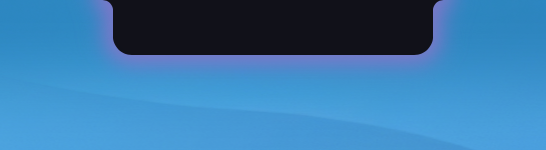
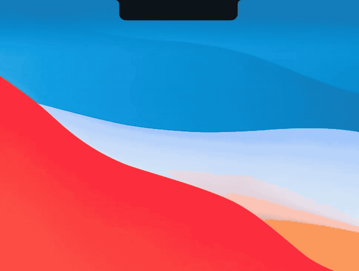
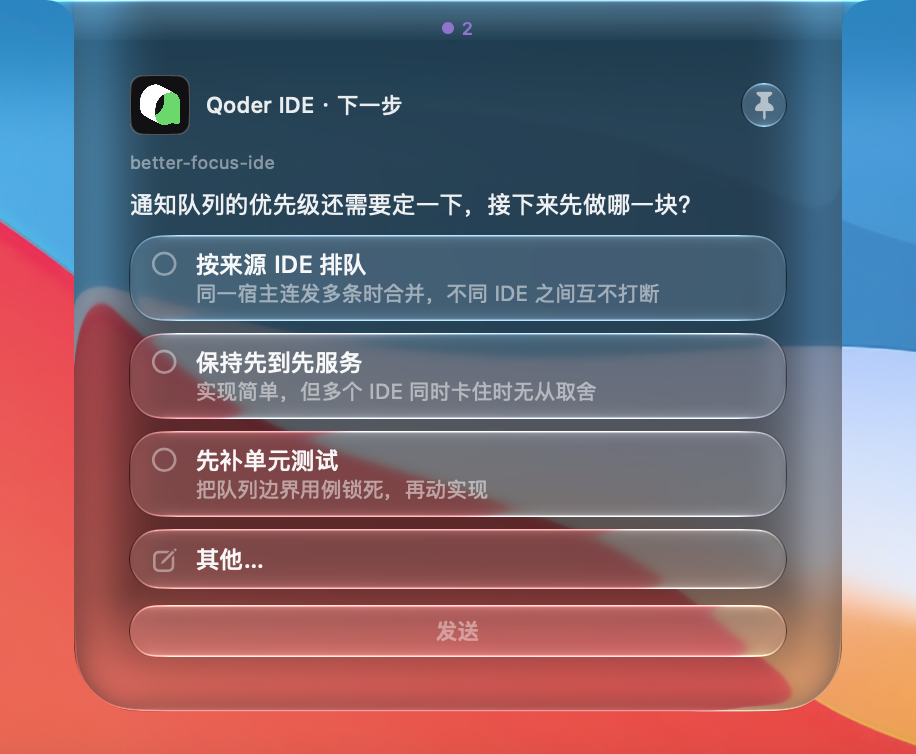
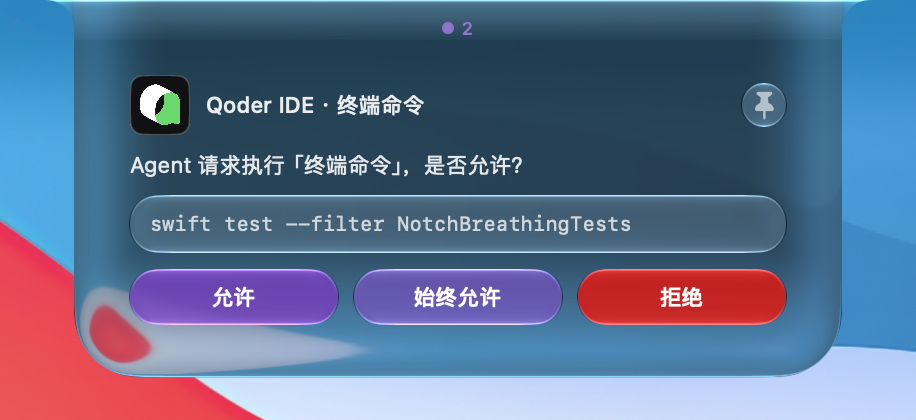
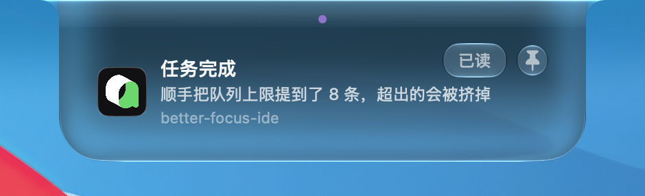
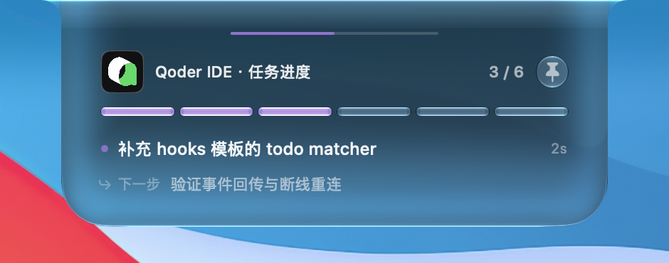
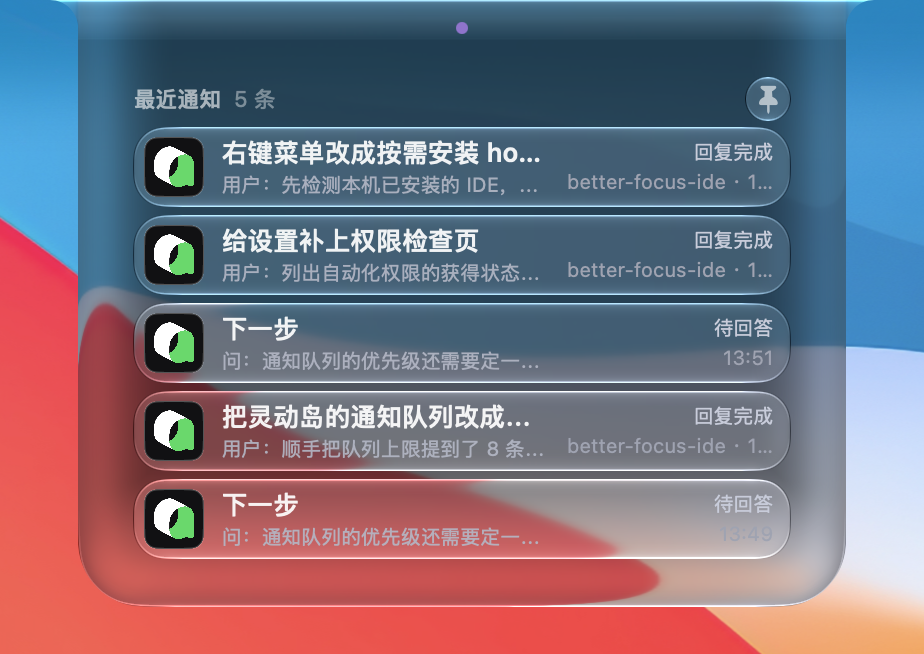
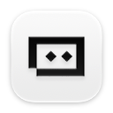

<div align="center">

[中文](README.md) · **English**

# 🏝️ BetterFocusIDE

**Turn your MacBook notch into a Dynamic Island for AI coding agents.**

[](LICENSE)
[]()
[-9cf.svg)]()
[]()
[]()

</div>

---

When an AI agent in Qoder, OpenCode, Cursor, or WorkBuddy needs to **ask you something**, **request permission**, or **finish a turn**, BetterFocusIDE pops an interactive card in the notch. Answer in one click, jump back to the IDE, or reply from the keyboard — without leaving the code you are typing.

BetterFocusIDE is a native macOS menu-bar accessory (no Dock icon). It is a Swift rewrite of the Python prototype `dynamic-Island-python-validate`, with animation and UI inspired by [Vorssaint](https://github.com/Vorssaint).

---

## Screenshots

These are real cards on the notch, triggered from the Debug page in Settings. They travel the same path as a hook.

<p align="center">

</p>

At rest it is a black capsule tucked against the physical notch. It stays there when there is nothing to handle. Unread notices make the edge breathe.

<p align="center">

</p>

When an agent asks a question, the capsule grows into a card instead of throwing up a window.

<p align="center">

</p>

A question card can be single-choice, multi-choice, or Other… with your own line of text. Once the card is focused, `1`–`9` picks an option and `Enter` sends the answer back to the agent. Several questions in one batch advance automatically.

<p align="center">

</p>

A permission card shows the command or file for this call. The three buttons are Allow, Always allow, and Deny. `Enter` is ignored here on purpose, so a stray key cannot approve it.

<p align="center">

</p>

A finished turn drops a banner. The body is the session's own wording, with the project name underneath. Click the banner to jump back to the IDE window that sent it.

<p align="center">

</p>

A todo list collapses into a segmented progress bar. The card names the step in progress and the one coming next. After it collapses, that progress line stays along the bottom of the capsule.

<p align="center">

</p>

Click the idle capsule to look back at the latest items: questions still waiting, permissions still waiting, and turns already finished.

---

## What each IDE can do

**Answer** means you choose on the island and the answer is written back to the host. **Notice** means a banner only — approve or answer in the host's own UI. **—** means the host has no such event, so the island never shows that card.

| | Host | Questions | Permissions | Turn done | Session end | Todos |
|---|---|:---:|:---:|:---:|:---:|:---:|
|   | Qoder / Qoder CN | Answer | Notice | ✓ | ✓ | ✓ |
|  | OpenCode | Answer | — | ✓ | — | ✓ |
|  | Cursor | — | — | ✓ | ✓ | — |
|  | WorkBuddy | Notice | Notice | ✓ | ✓ | ✓ |
|  | Claude Code | Answer | Notice | ✓ | ✓ | ✓ |
|   | Trae / Trae CN | Answer | Notice | ✓ | — | — |
|  | Kimi | Answer | Notice | ✓ | ✓ | ✓ |
|  | ChatGPT | — | Notice | ✓ | ✓ | — |
|  | GitHub Copilot | Answer | Notice | ✓ | ✓ | ✓ |

Qoder IDE, the Qoder CLI, and the JetBrains plugin share the Qoder row. The China build writes its config under `~/.qoder-cn`. Restart the IDE after a hook change.

**Qoder.app** (the desktop app, bundle `com.qoder.app`, not Qoder IDE) does not fire `PermissionRequest` for questions. It waits on `PreToolUse`, and the island opens an answerable question card, then hands the answer back. Permission confirmations and MCP elicitation still arrive only as `Notification`: the island shows a notice, and a click jumps back to Qoder's own dialog. Qoder IDE / Qoder CN questions still go through `PermissionRequest`.

A few hosts differ from a plain reading of the table:

- **Cursor** has no permission card. A before-shell or before-MCP hook must answer `allow`, `deny`, or `ask`, and each of those changes Cursor's own approval, so those events are not registered. Approval stays in Cursor. There is no question card and no todo card. Turn-complete and session-end notices still appear.
- **WorkBuddy** questions are not answered on the island. The host's own form appears first; the island only shows a notice, and a click jumps back so you can answer there. Permissions are notice-only as well. `settings.json` does not hot-reload — reopen the current session.
- **Trae / Trae CN** has no session-end event. The todo tool is visible in the chat, but hooks never receive it, so there is no progress card.
- **ChatGPT** (formerly Codex) has no `AskUserQuestion` tool name and no matching todo event, so those two cards never appear. After install, trust the hook once inside ChatGPT. Trust it again after the script changes.
- **OpenCode** has no permission notices and no session end.

Some hosts also show extra banners: a subtask finished, a document or browser page waiting for review, context about to be compacted or already compacted, a turn that did not finish, or a quota / sign-in failure. A click still jumps back to the original window. Failed tool calls are not announced.

---

## ✨ Features

- 🫧 **Dynamic Island motion** — spring-driven, frame-by-frame deformation. Expand and collapse is a liquid notch silhouette, not a hard pop
- 🪟 **Glass and shadow** — frosted material and an outer shadow while expanded; solid black, flush with the physical notch, while collapsed
- ❓ **Question cards** — single or multiple choice, an Other… free-text field, and paging through several questions
- 🔐 **Permission cards** — approve a tool call: Allow / Always allow / Deny
- ✅ **Turn-complete notices** — click to jump back to the IDE window; the title is the session's real first line
- ⌨️ **Keyboard replies** — number keys, `Y` / `A` / `N` decisions, `Enter` to send, `Esc` to collapse
- 📌 **Pin** — stay expanded, or collapse on its own when the moment passes
- 🕘 **History** — click the idle island to review the last 5 notices
- ⚙️ **Settings** — notification toggles, sound and haptics, card behavior
- 🔌 **Install what you use** — the list shows IDEs already on this Mac; hooks are written only for the ones you check
- 🛡️ **Single instance** — an `flock` startup lock so a second launch cannot stick around
- 🖥️ **Built-in notch first** — pinned to the internal notch display; it does not hop between screens with keyboard focus
- 🩺 **Doctor** — one pass over the socket, hook registration, and the answers directory

See [Screenshots](#screenshots) above.

---

## 📦 Requirements

| Item | Requirement |
|---|---|
| OS | macOS 14+ (Sonoma) |
| Chip | Apple Silicon (`arm64`) |
| Toolchain | Swift 5.9+ / Xcode 15+ |

---

## 🚀 Getting Started

### Build

`build.sh` in the repo compiles with SwiftPM, assembles the `.app`, and ad-hoc signs it:

```bash
git clone git@github.com:1264116203/better-focus-ide.git
cd better-focus-ide
./build.sh
# output: .build/debug/BetterFocusIDE.app
```

### Install and launch

```bash
cp -R .build/debug/BetterFocusIDE.app /Applications/
xattr -dr com.apple.quarantine /Applications/BetterFocusIDE.app   # clear Gatekeeper quarantine
open /Applications/BetterFocusIDE.app
```

After launch, a capsule sits in the notch and an icon appears in the status bar.

### Connect your AI coding tool

Click the status-bar icon and choose **安装 Hook / Plugin…** (menus and settings are in Chinese). The sheet lists supported IDEs already installed on this Mac, all checked by default, and writes hooks only for the ones you leave checked. Install is idempotent: it only adds or removes its own entries.

Which cards each host can show is in [What each IDE can do](#what-each-ide-can-do).

**Check that it works.** In the host, have the agent ask a multiple-choice question — a question card should appear in the notch. Cursor and ChatGPT have no question card; watch for the completion banner instead. Let a turn finish and the completion banner should appear. If nothing shows up, run [Doctor](#doctor).

---

## ⌨️ Keyboard shortcuts

> ⚠️ Shortcuts work **only after the island is the focused window** — click it once. It is a background app and will never steal keystrokes from your terminal or editor.

| Context | Key | Action |
|---|---|---|
| Question card | `1`–`9` | Select option N |
| Question card | `←` / `→` | Page through questions |
| Question card | `Enter` | Send the answer |
| Question card | `Tab` | Jump to the Other… field |
| Permission card | `Y` / `1` | Allow (this time) |
| Permission card | `A` / `2` | Always allow |
| Permission card | `N` / `3` | Deny |
| Anywhere | `Esc` | Collapse the card |
| Anywhere | `⌘ ,` | Open Settings |
| Anywhere | `⌘ ⇧ P` | Toggle the pin |

> Permission cards **deliberately ignore `Enter`**. A risky approval needs an explicit `Y` / `A` / `N`.

**Accidental-key guard.** Keys do nothing in four cases: the first 0.5 seconds after a card appears, while you are typing in Other…, while a card is fading out, and while a card is tucked inside the bubble.

---

## 📌 Pin

The pin in the top-right of every card toggles **pinned ⇄ on demand**:

- **Pinned (`pin.fill`, highlighted):** the card stays open. A turn-complete banner does not collapse on its own.
- **On demand (`pin`, slanted):** the banner collapses after its dwell time (5 seconds by default).

Questions, permissions, notices, todos, and history share one switch: **卡片固定展示** under Settings → **行为**. Flipping the pin on any card writes that setting, and the choice stays when another card appears or the app reopens.

---

## 🖥️ Notch display

- The island stays **pinned to the built-in notch display** (the screen whose `safeAreaInsets.top > 0`). It does not follow the screen that has keyboard focus.
- With more than one display, it **does not drift onto an external screen**, even when that screen is focused or is the main display.
- Plugging in or unplugging a display recalculates the position.
- On a machine with no notch, it falls back to the top center of that screen.

---

## 🗂️ Files

Everything lives under its own `BetterFocusIDE` namespace, so it can sit beside Vorssaint and the Python build:

```
~/Library/Application Support/BetterFocusIDE/
├── agent-events.sock          # event channel (Unix socket, newline-delimited JSON)
├── agent-events.sock.lock     # single-instance flock
├── answers/                   # replies written back for the host to read
├── settings.json              # user settings
└── logs/betterfocus.log       # log (5MB × 3, redacted)

~/.qoder/hooks/betterfocus-*.{sh,py}               # Qoder hook
~/.config/opencode/plugins/betterfocus-notify.js   # OpenCode plugin
~/.cursor/hooks/betterfocus-*.{sh,py}              # Cursor hook
~/.workbuddy/hooks/betterfocus-*.{sh,py}           # WorkBuddy hook
```

**Log environment variables** (for debugging):

```bash
BETTERFOCUS_LOG_STDERR=1   # also print to the terminal
BETTERFOCUS_LOG_LEVEL=info # debug / info / warning / error
```

---

## 🩺 Doctor

Status bar → **自检 (Doctor)…** checks each item and suggests a fix:

- Whether the socket is alive (a probe connection)
- Whether each host's hook or plugin file is in place (hosts not installed on this Mac are skipped)
- Whether the host config actually lists our entry
- Whether the answers directory is writable and the settings file is readable

> If the app is installed and no card appears, the host hook is usually unregistered or the socket never came up. Run Doctor first.

---

## 🏗️ Architecture

Four layers, inherited from the Python reference:

1. **Window shell** — `NotchPanel` (`NSPanel`): borderless, transparent, `level = statusBar + 1`
2. **Animation** — `NotchCanvas` (`NSView`): `CAKeyframeAnimation` drives the mask path
3. **Bridge** — `NotchHostingView` (`NSHostingView`): AppKit ↔ SwiftUI
4. **Content** — `NotchView` (SwiftUI): every card, with state owned by `NotchService`

Each card type has its own state-machine controller:

| Card | Controller | Trigger | Reply |
|---|---|---|---|
| Question | `QuestionController` | `question_requested` | JSON written to `answers/<session>_<question>.json` |
| Permission | `PermissionController` | `permission_requested` | JSON written to `answers/<session>_<request>.json` |
| Notice | `NoticeController` | `turn_finished` / `session_ended` | Dismisses on its own after a timeout |
| History | `HistoryController` | Internal | Read-only panel (last 5) |

The full architecture notes are in [`AGENTS.md`](AGENTS.md) (Chinese).

---

## 📁 Project Structure

```
├── Package.swift              # SwiftPM manifest (library + thin executable)
├── build.sh                   # build, assemble the .app, ad-hoc sign
├── Resources/                 # Info.plist, entitlements, icons
├── Sources/BetterFocusIDE/
│   ├── Models/                # plain data types
│   ├── Services/              # socket, installers, controllers, Doctor
│   └── UI/                    # SwiftUI views (forced dark mode)
└── Tests/                     # unit tests
```

---

## 🧪 Tests

```bash
swift test
```

---

## 📜 License

[GPL-3.0-or-later](LICENSE) © 2026 BetterFocusIDE

This repo includes notch window and animation code adapted from [Vorssaint](https://github.com/Vorssaint) (GPL-3.0). The whole project is distributed under the GPL. Keep the license header if you reuse it internally.

---

## 🙏 Acknowledgments

- [Vorssaint](https://github.com/Vorssaint) — Dynamic Island animation and UI reference
- `dynamic-Island-python-validate` — the original Python prototype

---

<div align="center">

Made with ❤️ for developers who live in the terminal.

</div>
