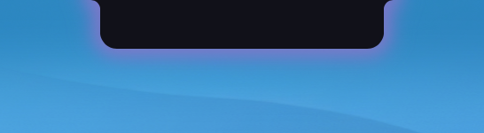
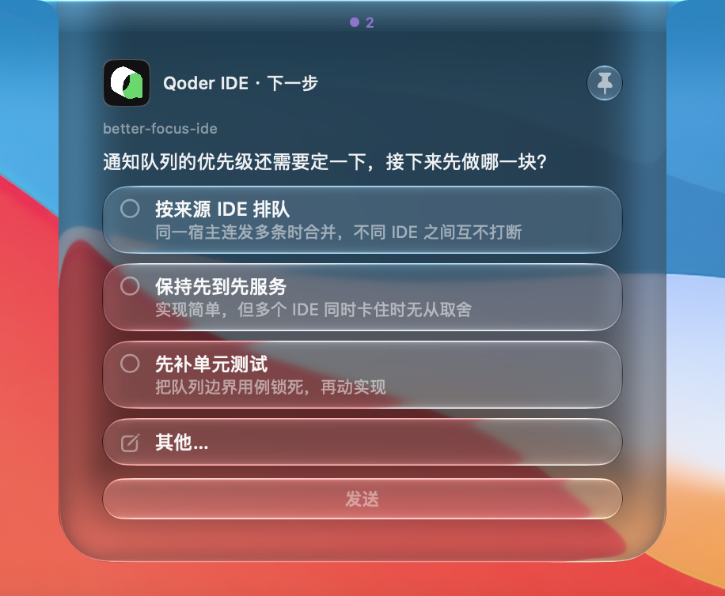
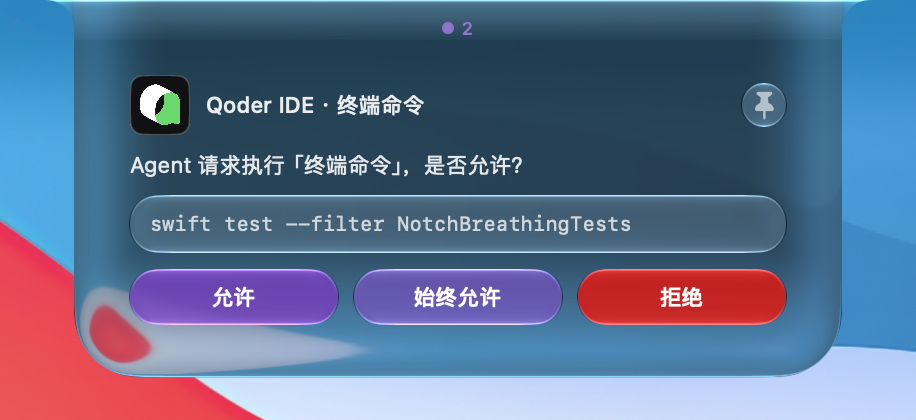
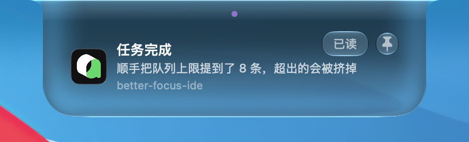
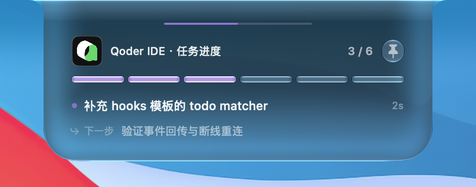
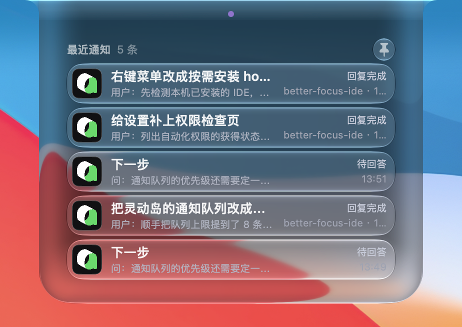
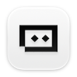

<div align="center">

# 🏝️ BetterFocusIDE

**把 MacBook 的刘海，变成面向 AI 编码智能体的「灵动岛」通知助手**

Turn your MacBook notch into a Dynamic-Island-style assistant for AI coding agents.

[](LICENSE)
[]()
[-9cf.svg)]()
[]()
[]()

</div>

---

当 Qoder / OpenCode / Cursor / WorkBuddy 里的 AI Agent 需要**向你提问**、**申请权限**、或**完成一轮回复**时，BetterFocusIDE 会在刘海区域弹出可交互卡片——**一键回答、点一下跳回 IDE、键盘秒答**，全程不打断你正在敲的代码。

BetterFocusIDE is a native macOS menu-bar accessory app (no Dock icon) that surfaces agent **questions**, **permission requests**, and **turn-completion notices** as interactive cards in the notch. It's a Swift rewrite of the Python prototype `dynamic-Island-python-validate`, with animation and UI inspired by [Vorssaint](https://github.com/Vorssaint).

---

## 实拍

下面都是刘海上的真实卡片，从设置里的「调试」页打出来，和 hook 走的是同一条链路。

<p align="center">

</p>

平时只剩一枚黑胶囊，贴着物理刘海。没有要处理的事情时它就停在这里；有未读通知时，边缘会轻轻呼吸。

<p align="center">

</p>

智能体抛来问题时，胶囊涨成一张卡片，而不是突然弹出一个窗口。

<p align="center">

</p>

提问卡片可以单选、多选，也可以选「其他…」自己写一句。卡片成为焦点后，`1`–`9` 选第几项，`Enter` 把答案送回智能体。一次带来多道题时，答完自动翻到下一题。

<p align="center">

</p>

权限卡片给出这次要执行的命令或文件，三个按钮是「允许」「始终允许」「拒绝」。这里故意不认 `Enter`，避免误批。

<p align="center">

</p>

一轮做完会落下横幅，正文取自这次会话里的原话，下面标着项目名。点一下横幅，跳回发出这条通知的 IDE 窗口。

<p align="center">

</p>

待办会收成一条分段进度。当前在做哪一步、下一步是什么，都写在卡上；收起之后，胶囊下沿还留着这条进度线。

<p align="center">

</p>

点一下空闲的胶囊，可以回看最近几条：待回答的提问、待审批的权限，以及已经完成的回合。

---

## 各 IDE 能做什么

「作答」是在岛上选完，答案写回宿主。「提醒」只出横幅，批准或作答仍在宿主自己的界面里。「—」是这个宿主的事件里没有这一项，岛上不会出现。

| | 宿主 | 提问 | 权限 | 回合完成 | 会话结束 | 待办 |
|---|---|:---:|:---:|:---:|:---:|:---:|
|   | Qoder / Qoder CN | 作答 | 提醒 | ✓ | ✓ | ✓ |
|  | OpenCode | 作答 | — | ✓ | — | ✓ |
|  | Cursor | — | 提醒 | ✓ | ✓ | — |
|  | WorkBuddy | 提醒 | 提醒 | ✓ | ✓ | ✓ |
|  | Claude Code | 作答 | 提醒 | ✓ | ✓ | ✓ |
|   | Trae / Trae CN | 作答 | 提醒 | ✓ | — | — |
|  | Kimi | 作答 | 提醒 | ✓ | ✓ | ✓ |
|  | ChatGPT | — | 提醒 | ✓ | ✓ | — |
|  | GitHub Copilot | 作答 | 提醒 | ✓ | ✓ | ✓ |

Qoder 的 IDE、CLI 和 JetBrains 插件共用这一行，国内版写在 `~/.qoder-cn`。改完 hook 要重启 IDE 才生效。

几处和表上的字不一样的地方：

- **Cursor** 的权限只提醒：终端命令和 MCP 调用会在岛上亮一条通知，点一下跳回去，批准仍在 Cursor 自己的对话框里。没有提问卡，也没有待办。读文件和通用工具调用不接，那些事件没有「交给用户审批」的答复。
- **WorkBuddy** 的提问不在岛上作答。宿主自己的问卷会先出现，岛上只亮一条提醒，点一下跳回去答。权限同样只提醒。`settings.json` 改完不会热加载，要重开当前会话。
- **Trae / Trae CN** 没有会话结束事件。待办工具虽然在对话里看得到，hook 收不到，所以没有进度卡。
- **ChatGPT**（原 Codex）的工具名里没有 `AskUserQuestion`，也没有能对上的待办事件，所以这两张卡不出。装好之后还要在 ChatGPT 里把 hook 信任一次，改过脚本要重新信任。
- **OpenCode** 没有权限提醒，也没有会话结束。

部分宿主还会多几张横幅：子任务完成、文档或浏览器待审、上下文即将压缩或已经压缩、这一轮没有完成、额度或登录失效。点一下同样跳回原来的窗口。工具调用失败不通知。

---

## ✨ Features

- 🫧 **灵动岛动画** — 弹簧逐帧形变，展开/收起是「液态」刘海轮廓，不是硬弹
- 🪟 **玻璃 + 投影** — 展开态磨砂材质 + 窗口外投影，收起态纯黑融入物理刘海
- ❓ **提问卡片** — 单选/多选、「其他…」自定义输入、多题翻页
- 🔐 **权限卡片** — 工具调用审批：允许 / 始终允许 / 拒绝
- ✅ **回复完成通知** — 点一下跳回对应 IDE 窗口，标题取会话真实首条原话
- ⌨️ **键盘答卡** — 数字键、`Y`/`A`/`N` 决策、`Enter` 发送、`Esc` 收起
- 📌 **图钉固定** — 固定保持展开 ⇄ 按需自动收起
- 🕘 **通知历史** — 点空闲的岛回顾最近 5 条通知
- ⚙️ **设置面板** — 通知开关、声音/震动、卡片行为偏好
- 🔌 **按需接入** — 勾选这台 Mac 上已安装的 IDE，只给选中的写入 hook
- 🛡️ **单实例互斥** — `flock` 启动锁，防止重复启动
- 🖥️ **刘海屏优先** — 固定钉在内置刘海屏，不随焦点在两屏间跳
- 🩺 **Doctor 自检** — 一键排查 socket / hook 注册 / 答案目录是否就绪

画面见上面的 [实拍](#实拍)。

---

## 📦 Requirements

| 项 | 要求 |
|---|---|
| OS | macOS 14+ (Sonoma) |
| 芯片 | Apple Silicon (`arm64`) |
| 工具链 | Swift 5.9+ / Xcode 15+ |

---

## 🚀 Getting Started

### 构建

用仓库里的 `build.sh` 打包（SwiftPM 编译 → 手动组装 `.app` → ad-hoc 签名）：

```bash
git clone git@github.com:1264116203/better-focus-ide.git
cd better-focus-ide
./build.sh
# 产物：.build/debug/BetterFocusIDE.app
```

### 安装并启动

```bash
cp -R .build/debug/BetterFocusIDE.app /Applications/
xattr -dr com.apple.quarantine /Applications/BetterFocusIDE.app   # 绕过 Gatekeeper
open /Applications/BetterFocusIDE.app
```

启动后，屏幕顶部刘海会出现胶囊，状态栏也会出现一个图标。

### 接入你的 AI 编码工具

点状态栏图标 → **安装 Hook / Plugin…**。先列出这台 Mac 上已经安装、而且受支持的 IDE，默认全部勾选，只给勾中的写入 hook。安装是幂等的，只增删自己的条目。

每个宿主能弹出哪些卡片，见 [各 IDE 能做什么](#各-ide-能做什么)。

**接入后验证**：在宿主里让 Agent 提一个选择题，刘海应弹出提问卡片（Cursor、ChatGPT 没有这张卡，改看完成横幅）；让它跑完一轮，应弹完成横幅。没反应就用下面的 [Doctor 自检](#doctor-自检)。

---

## ⌨️ 键盘快捷键

> ⚠️ 键盘快捷键**只在灵动岛成为当前焦点窗口后生效**——先点一下岛让它聚焦。岛是后台应用，绝不会主动抢走你终端 / 编辑器里正在敲的字。

| 场景 | 键 | 动作 |
|---|---|---|
| 提问卡片 | `1`–`9` | 选中第 N 个选项 |
| 提问卡片 | `←` / `→` | 多题翻页 |
| 提问卡片 | `Enter` | 发送答案 |
| 提问卡片 | `Tab` | 跳到「其他…」自定义输入框 |
| 权限卡片 | `Y` / `1` | 允许（本次） |
| 权限卡片 | `A` / `2` | 始终允许 |
| 权限卡片 | `N` / `3` | 拒绝 |
| 通用 | `Esc` | 收起卡片 |
| 通用 | `⌘ ,` | 打开设置 |
| 通用 | `⌘ ⇧ P` | 切换图钉固定 |

> 权限卡**刻意不认 `Enter`**：高危操作要有明确的 `Y`/`A`/`N` 意图，防误批。

**内置防误触保护**：卡片刚出现 0.5 秒内、正在「其他…」里打字时、卡片淡出中、卡片收在气泡里——这四种情况按键一律不响应。

---

## 📌 图钉固定模式

每张卡右上角的图钉 = **固定 ⇄ 按需** 开关：

- **固定（`pin.fill` 高亮）**：卡片保持展开，回复完成横幅不自动收起。
- **按需（`pin` 斜置）**：横幅按停留时长（默认 5 秒）自动收起。

新卡片默认模式由 `设置 → 卡片行为 → 新卡片默认固定` 决定；单张卡上的临时切换不影响该偏好。

---

## 🖥️ 刘海屏行为

- 灵动岛**固定钉在内置刘海屏**（`safeAreaInsets.top > 0` 的那块显示器），不跟随键盘焦点的主屏。
- 多显示器下，即使焦点切到外接屏、或外接屏是主屏，岛也**不会漂到外接屏**。
- 插上 / 拔掉显示器时会自动重算位置。
- 机器没有刘海屏时，退化为在该屏顶部居中显示。

---

## 🗂️ 文件位置

全部在独立命名空间 `BetterFocusIDE` 下，可与 Vorssaint / Python 版并存：

```
~/Library/Application Support/BetterFocusIDE/
├── agent-events.sock          # 事件通道（Unix socket，换行分隔 JSON）
├── agent-events.sock.lock     # 单实例 flock 锁
├── answers/                   # 作答结果回写目录
├── settings.json              # 用户设置
└── logs/betterfocus.log       # 运行日志（5MB × 3 轮转，脱敏）

~/.qoder/hooks/betterfocus-*.{sh,py}          # Qoder Hook
~/.config/opencode/plugins/betterfocus-notify.js   # OpenCode Plugin
~/.cursor/hooks/betterfocus-*.{sh,py}         # Cursor Hook
~/.workbuddy/hooks/betterfocus-*.{sh,py}      # WorkBuddy Hook
```

**日志环境变量**（排障用）：

```bash
BETTERFOCUS_LOG_STDERR=1   # 同步打到终端
BETTERFOCUS_LOG_LEVEL=info # 级别：debug/info/warning/error
```

---

## 🩺 Doctor 自检

状态栏 → **自检（Doctor）…**，逐项检查并给修复建议：

- Socket 是否存活（探活连接）
- 各宿主 Hook / Plugin 文件是否就位（本机没装的宿主自动跳过）
- 宿主配置里是否登记了我们的条目
- 答案目录是否可写、设置文件是否可读

> 装了但卡片不弹，八成是宿主端 hook 没注册成功或 socket 没起来，先跑这个。

---

## 🏗️ Architecture

四层灵动岛栈（继承自 Python 参考实现）：

1. **窗口外壳** — `NotchPanel`（`NSPanel`）：无边框、透明、`level = statusBar + 1`
2. **动画层** — `NotchCanvas`（`NSView`）：`CAKeyframeAnimation` 驱动遮罩路径
3. **桥接层** — `NotchHostingView`（`NSHostingView`）：桥接 AppKit ↔ SwiftUI
4. **内容层** — `NotchView`（SwiftUI）：所有卡片 UI，状态由 `NotchService` 驱动

四种卡片各有一个专用状态机控制器：

| 卡片类型 | 控制器 | 触发事件 | 回答机制 |
|---|---|---|---|
| 提问 | `QuestionController` | `question_requested` | 写 JSON 到 `answers/<session>_<question>.json` |
| 权限 | `PermissionController` | `permission_requested` | 写 JSON 到 `answers/<session>_<request>.json` |
| 通知 | `NoticeController` | `turn_finished` / `session_ended` | 超时后自动消失 |
| 历史 | `HistoryController` | 内部 | 只读面板（最近 5 条） |

完整的架构说明见 [`AGENTS.md`](AGENTS.md)。

---

## 📁 Project Structure

```
├── Package.swift              # SwiftPM 清单（库目标 + 瘦可执行目标）
├── build.sh                   # 构建 + .app 组装 + ad-hoc 签名
├── Resources/                 # Info.plist、entitlements、图标
├── Sources/BetterFocusIDE/
│   ├── Models/                # 纯数据类型
│   ├── Services/              # Socket / Installer / 各控制器 / Doctor
│   └── UI/                    # SwiftUI 视图（强制深色模式）
└── Tests/                     # 单元测试
```

---

## 🧪 运行测试

```bash
swift test
```

---

## 📜 License

[GPL-3.0-or-later](LICENSE) © 2026 BetterFocusIDE

本仓库含从 [Vorssaint](https://github.com/Vorssaint)（GPL-3.0）参考裁剪的灵动岛窗口 / 动画代码，整体按 GPL 分发，内部使用请保留许可证头。

---

## 🙏 Acknowledgments

- [Vorssaint](https://github.com/Vorssaint) — 灵动岛动画与 UI 参考
- `dynamic-Island-python-validate` — 原始 Python 原型

---

<div align="center">

Made with ❤️ for developers who live in the terminal.

</div>
